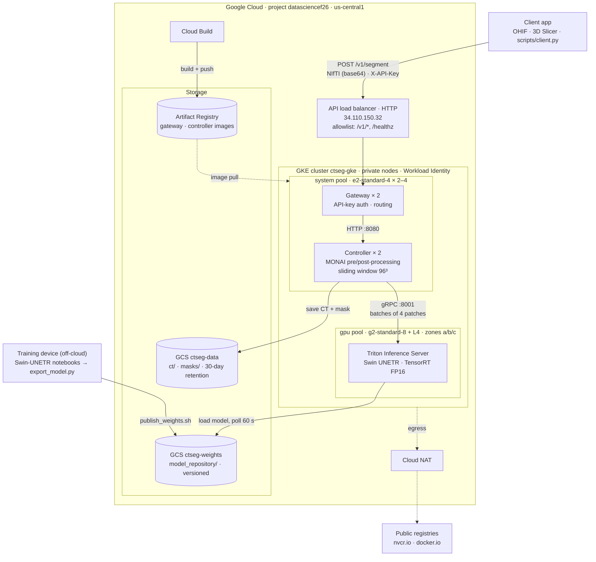
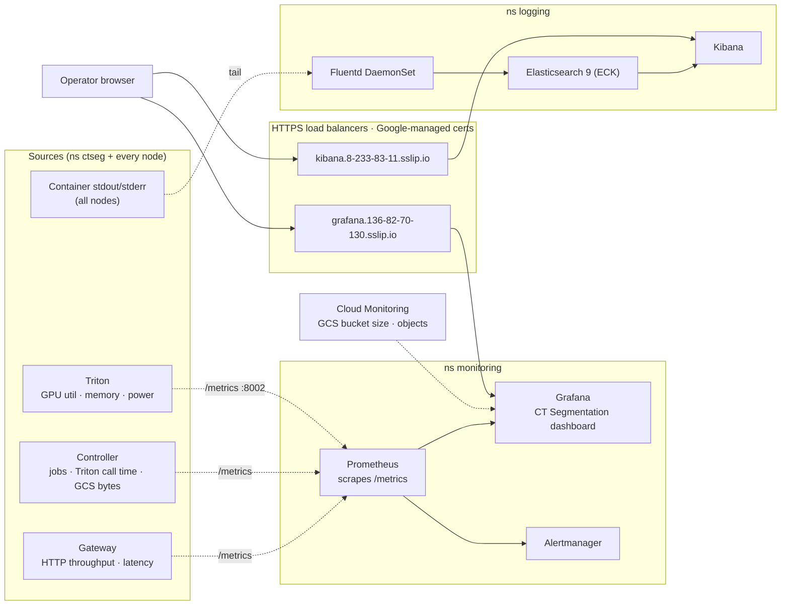
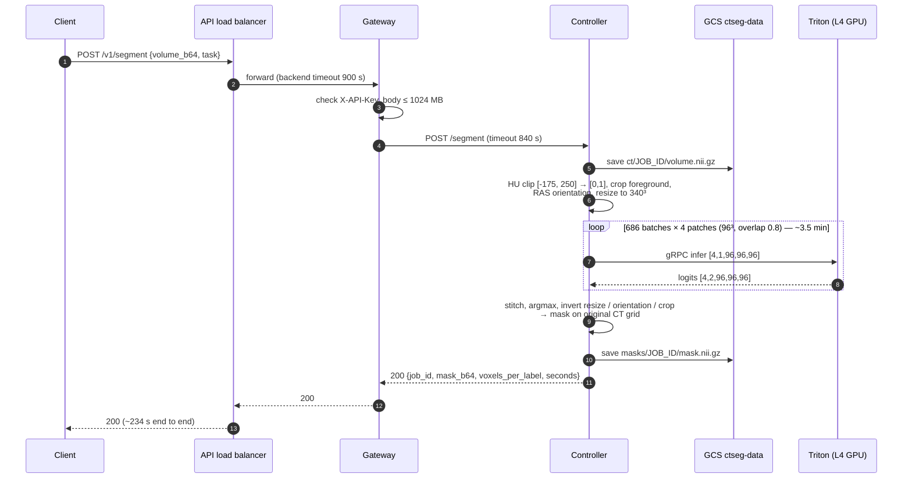
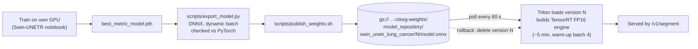

# System architecture

The CT segmentation service as deployed on GCP project `datasciencef26` and managed by Terraform (`terraform/1-infra` and `terraform/2-platform`). For the original design sketch, see [architecture.jpg](architecture.jpg). For the client API, see [api_doc.md](api_doc.md).

## Overview

How a scan travels from a client to the GPU and back, and where models and images come from.

**Legend:** solid arrows are the request and model data path; dashed arrows are image pulls and outbound traffic.

## Observability

Metrics and logs, and how the operator reaches them. The Grafana and Kibana UIs are public over HTTPS with an admin login; Prometheus stays private.

## Request flow: `POST /v1/segment`

Timings are from a real run on `lung_095` (512×512×231 CT, TensorRT FP16, 1× L4).

## Model lifecycle

## Component reference

| Layer | Component | Where it's defined |
|---|---|---|
| Edge | 3 GKE Ingresses → Google external HTTP(S) LBs. The API path allowlist is `/v1/*` and `/healthz`; Grafana and Kibana use HTTPS with a redirect. | `2-platform/gateway.tf`, `ui.tf` |
| Network | VPC `ctseg-vpc`, private nodes, Cloud NAT for egress, 3 reserved global IPs | `1-infra/network.tf` |
| Compute | GKE zonal cluster, `system` pool (e2-standard-4, 2–4 nodes), `gpu` pool (g2-standard-8 + L4, zones a/b/c, 0–2 nodes) | `1-infra/gke.tf` |
| App | Gateway, Controller and Triton Deployments. Gateway and Controller have HPAs, PDBs, `safe-to-evict: false` and a 900 s graceful shutdown. | `2-platform/gateway.tf`, `controller.tf`, `triton.tf` |
| Model | Swin UNETR ONNX on Triton 25.01, TensorRT FP16, engine cache in an emptyDir | `model_repository/*/config.pbtxt` |
| Storage | GCS data bucket (30-day retention) and weights bucket (versioned); Artifact Registry | `1-infra/storage.tf` |
| Identity | One service account per workload via Workload Identity: controller (data bucket), triton (weights bucket, read-only), grafana (monitoring viewer), trainer (weights bucket), build (Artifact Registry push) | `1-infra/iam.tf` |
| Metrics | kube-prometheus-stack (Prometheus, Grafana, Alertmanager), scraping annotated pods and Triton GPU metrics; Cloud Monitoring data source for GCS | `2-platform/monitoring.tf` |
| Logs | ECK Elasticsearch 9 + Kibana; Fluentd DaemonSet (ES 8 client, label de-dotting) | `2-platform/logging.tf`, `values/fluentd.yaml` |
